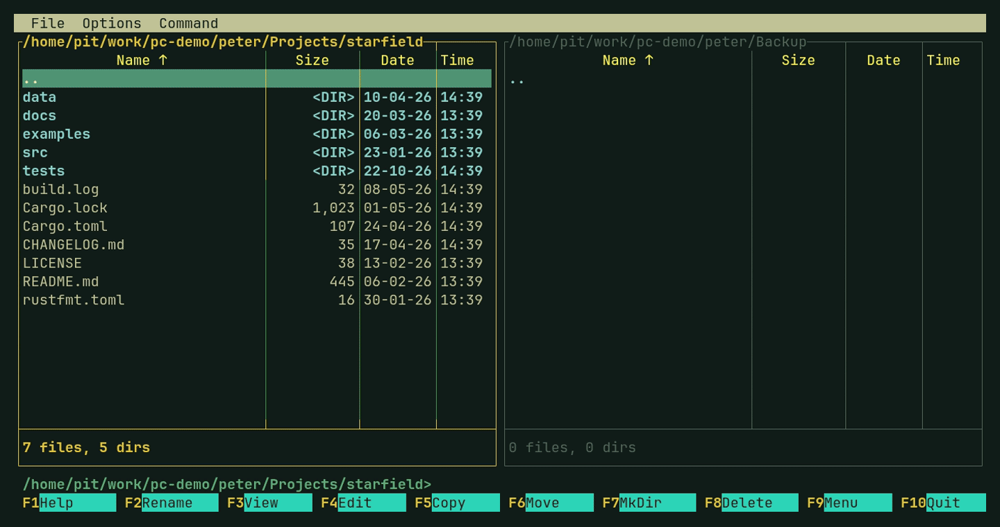
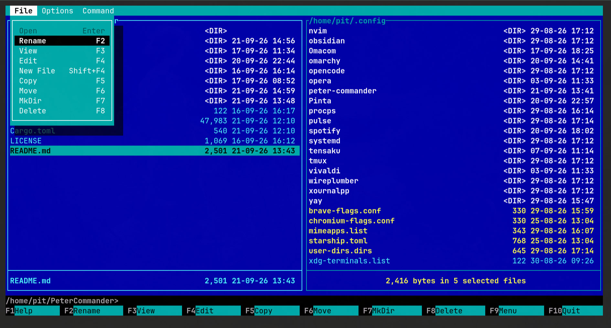

# Peter Commander

[](https://github.com/piotrsrodka/peter-commander/actions/workflows/rust.yml)

**Norton Commander, reborn for the modern terminal.** Two panes, F-keys,
a command line at the bottom: the file manager you remember from DOS,
written in Rust with [Ratatui](https://ratatui.rs). Made for
[Omarchy](https://omarchy.org) and follows its theme, and runs on any
Linux, macOS, or Windows.



Miss the blue? Switch on the classic Norton Commander colors in
Options > Settings:



```sh
cargo install peter-commander
```

## Why Peter Commander?

- **The NC muscle memory, unchanged.** F3 view, F4 edit, F5 copy, F6 move,
  F7 mkdir, F8 delete, Tab to switch panes, Ctrl+O for command output.
- **Matches your desktop.** Picks up the current Omarchy theme, so it
  looks like the rest of your system instead of a 1990s time capsule
  (unless you want the time capsule).
- **Safe by default.** Delete goes to the desktop trash; Shift+F8 when you
  really mean it. Bulk renames warn before anything is overwritten.
- **Works without a desktop.** On a bare Linux text console it still
  draws proper frames and colors, and shows images full-screen by itself.
- **One small binary.** No Python, no plugins to set up. `cargo install`,
  `makepkg` on Arch, or a single `.exe` on Windows.

## Features

- Dual-pane file browsing; the panes (and the F3 preview) follow changes
  made on disk by other programs
- File operations: rename, copy, move, mkdir, new file, delete
- Delete to the desktop trash (optional, on by default); Shift+F8 deletes permanently
- Copy/move with a progress bar, cancellable, can be sent to the background
- Sort by name, type (extension), size, or date (Command menu), remembered per pane
- Quick search: jump to a file by typing part of its name (Command menu)
- Rename selected files together in your `$EDITOR`, with a warning before anything is overwritten
- Respects theme selection in Omarchy
- Quick preview (F3) for text, directories, binaries and images (Sixel, Kitty or iTerm2 graphics, colored half blocks elsewhere);
  Tab onto it and Ctrl+F finds in the text (F3/Shift+F3 next/previous, first 1 MB of big files);
  Esc closes it
- Built-in text editor (F4) in the other pane, or full screen with F4 again:
  Notepad keys (Shift to select, Ctrl+arrows by word, Ctrl+S/Z/Y/A/C/X/V,
  Ctrl+F find with F3/Shift+F3 for the next/previous match), optional
  line wrap (Edit or Options menu, shared with the F3 preview, which is
  scrolled sideways with ←/→ when unwrapped), keeps line endings and tabs
  as they are, F2 renames the file being edited, File > Save As, Command >
  Open Editor starts an untitled text, Tab switches the keyboard
  between the editor and the file list beside it, asks before unsaved
  changes are lost, and Esc goes back to the quick view you came from; full screen can
  hide the menu bar (focus mode, Settings); or edit in your `$EDITOR`
  instead (Settings)
- Runs executable scripts and binaries directly
- Opens images, PDFs, audio, video, and HTML in your system's default app
- On a bare Linux console (tty), shows images full-screen itself, with F3 or Enter (←/→ next image, Esc to return)
- Built-in command-line prompt, with `cd` support; pasting into it never
  runs anything (only the first line goes in)
- Ctrl+O shows previous command output
- Configurable settings: hidden files, F3 preview mode, F4 editor and its
  focus mode, trash

## Usage

```sh
peter-commander                    # current dir, or last session (see Settings)
peter-commander ~/projects         # left pane in ~/projects
peter-commander ~/projects ~/tmp   # left and right pane
peter-commander --version          # also -v, -V, -version
peter-commander --help
```

A directory given on the command line wins over where that pane would
otherwise start (including the "Restore last session" setting). With the
`pc` alias from the install script, `pc ~/projects` works the same.

## pce — the editor alone

`pce` is Peter Commander's built-in editor on its own, full screen, with the
same keys (F1 shows them), theme and settings — for quick edits from the
shell, and as `$EDITOR`:

```sh
pce notes.txt                      # edit a file (one not there yet is made on the first save)
pce +12 src/main.rs                # starting at line 12
pce                                # an untitled text; Save asks for a name
git config --global core.editor pce
export EDITOR=pce                  # crontab -e, and the rest
pce .                              # a directory: Peter Commander itself, there
```

Given a directory, as tools that run `$EDITOR .` do (expecting nvim's
file browser), it starts the whole file manager with its left pane there,
just like `peter-commander DIR`.

Esc, F10 or Ctrl+Q close it, asking first about unsaved changes. It
comes with `cargo install peter-commander` (a small launcher for the
main binary), the Arch package and `scripts/install.sh`;
`peter-commander --edit [+N] [FILE]` is the same thing. (`cargo install`
puts `pce` in `~/.cargo/bin` too; if another crate's `pce` is already
there, use `cargo install --force peter-commander`, or
`cargo install peter-commander --bin peter-commander` to skip it.)

## Installing

Already have Rust? This works on Linux, macOS, and Windows:

```sh
cargo install peter-commander
```

### Arch Linux / Omarchy

```sh
git clone https://github.com/piotrsrodka/peter-commander.git
cd peter-commander/packaging/arch
makepkg -si
```

Installs `peter-commander` system-wide as `/usr/bin/peter-commander`.
Requires sudo.

### Other Linux

**Step 1 — install Rust** (skip if `cargo --version` already works):

```sh
curl --proto '=https' --tlsv1.2 -sSf https://sh.rustup.rs | sh
```

**Step 2 — build and install:**

```sh
git clone https://github.com/piotrsrodka/peter-commander.git
cd peter-commander
./scripts/install.sh
```

No sudo needed. Installs to `~/.local/bin` and sets up a `pc` alias.

### macOS

**Step 1 — install Rust** (skip if `cargo --version` already works):

```sh
brew install rust
```

**Step 2 — build and install:**

```sh
git clone https://github.com/piotrsrodka/peter-commander.git
cd peter-commander
./scripts/install.sh
```

No sudo needed. Installs to `~/.local/bin` and sets up a `pc` alias.

### Windows

Download `peter-commander.exe` from the
[latest release](https://github.com/piotrsrodka/peter-commander/releases/latest)
and run it — no installer needed. For `pce`, put `pce.exe` from the same
release in the same folder.

---

Peter Commander is a TUI app and needs a real interactive terminal — it
won't run under a non-interactive script or with piped output.

## License

MIT — see [LICENSE](LICENSE).
